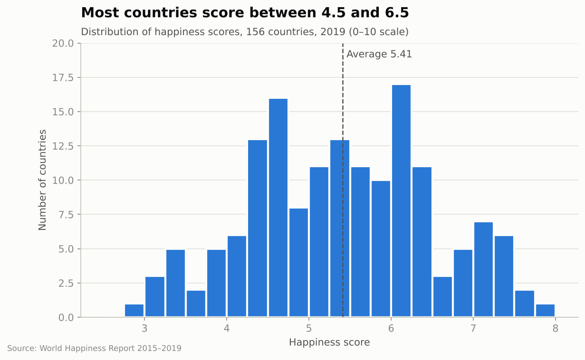
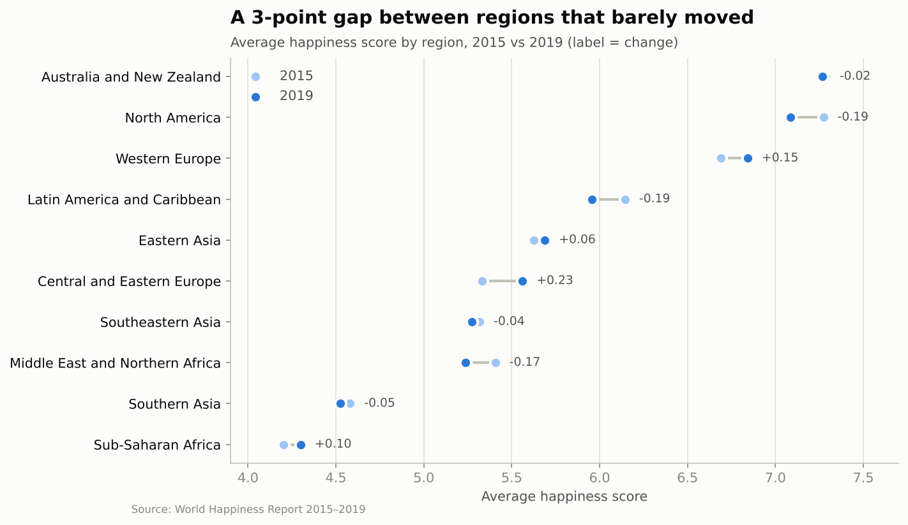
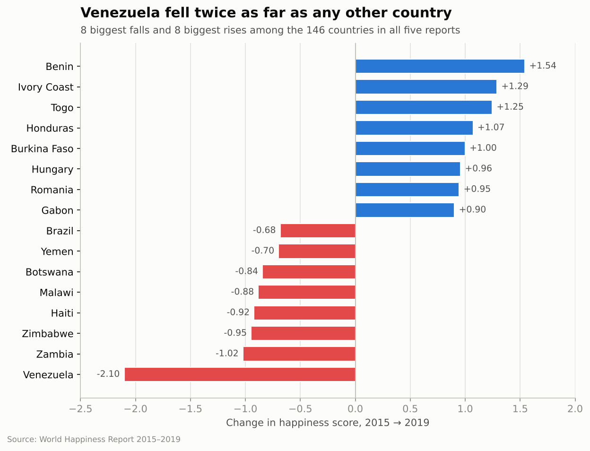
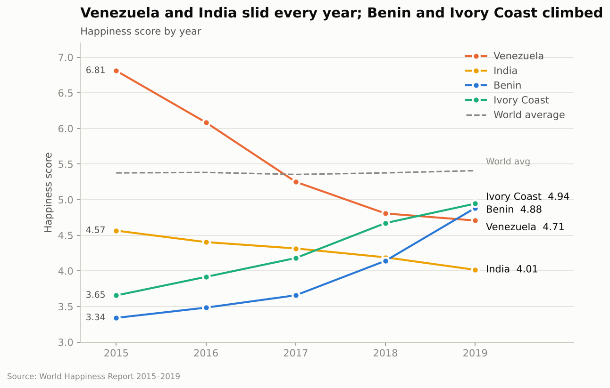
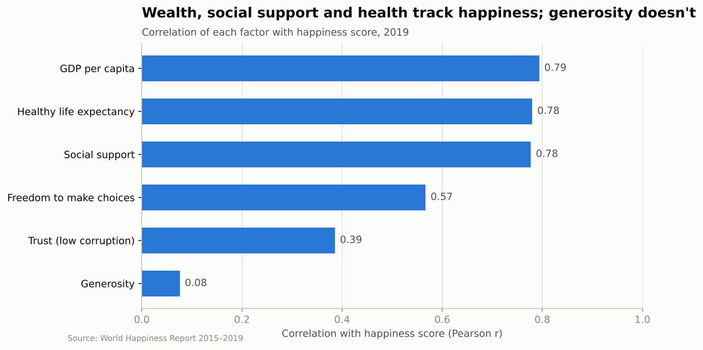
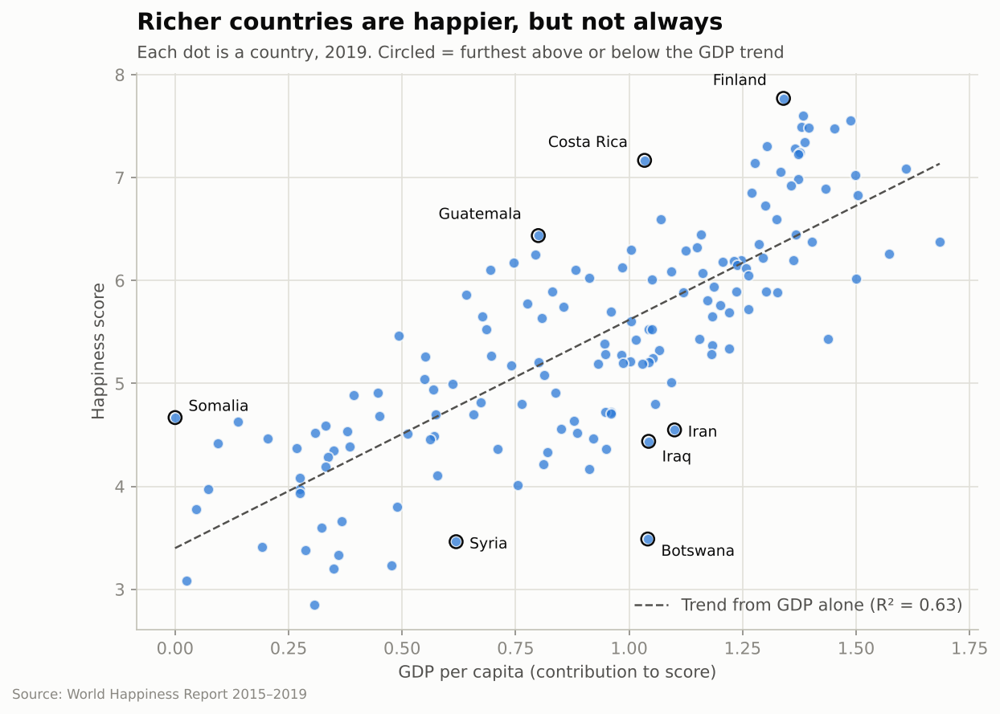
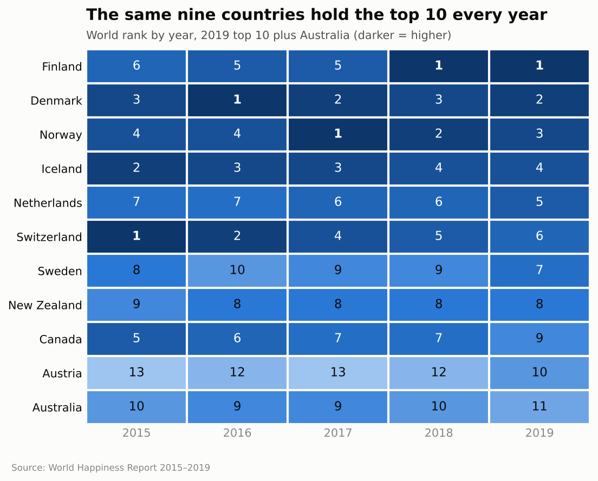

# World Happiness Report 2015–2019: Key Findings

## What this data is

Every year the World Happiness Report asks people in about 155 countries one question: *"Imagine a ladder from 0 (the worst possible life) to 10 (the best possible life). Which step are you on today?"* A country's **happiness score** is the average answer.

The report then estimates how much of each score comes from six factors:

| Factor | What it means in plain words |
|---|---|
| GDP per capita | How wealthy the country is |
| Social support | Having someone to count on when things go wrong |
| Healthy life expectancy | How many years people live in good health |
| Freedom | Feeling free to make your own life choices |
| Trust | Believing the government and businesses aren't corrupt |
| Generosity | How much people donate to charity |

This repo has one file per year (`World_Happiness_Report/2015.csv` to `2019.csv`).

## The short version

1. **The happiest countries barely change.** The same nine countries, mostly in Northern Europe, were in the top 10 every year.
2. **The world as a whole didn't get happier.** The global average stayed at about 5.4 out of 10 for all five years.
3. **Some individual countries changed a lot.** Venezuela fell the furthest by far. Several West African countries rose the most.
4. **Money matters, but so do health and friends.** Wealth, health and social support track happiness about equally. Generosity hardly matters at all.
5. **Money isn't everything.** Some countries, such as Costa Rica, are much happier than their wealth predicts. Others, such as Botswana, are much less happy.

---

## 1. Most countries land in the middle



**How to read it:** each bar counts how many countries scored within a quarter-point range. Taller bars mean more countries scored there.

**What it shows:** most countries score between 4.5 and 6.5. The average is **5.41**. Very few countries are at the extremes: only a handful score above 7 or below 3.5. The happiest country (Finland, 7.77) scores almost 5 points higher than the least happy (South Sudan, 2.85).

## 2. Where you live matters, and the gap isn't closing



**How to read it:** each row is a region. The light dot is its average score in 2015 and the dark dot is 2019. The number shows how much it changed.

**What it shows:**
- Australia/New Zealand, North America and Western Europe sit at the top (about 6.8–7.3).
- Sub-Saharan Africa and Southern Asia sit at the bottom (about 4.3–4.5).
- The gap between the top and bottom regions is about **3 points**, and it hardly moved in five years.
- **Central and Eastern Europe improved the most** (+0.23). Latin America, North America and the Middle East each dropped by about 0.2.

## 3. Venezuela fell the furthest; West Africa rose the most



**How to read it:** blue bars are countries that got happier between 2015 and 2019, and red bars are countries that got less happy. Longer bars mean bigger changes. Only the 146 countries that appear in all five reports are included.

**What it shows:**
- **Venezuela dropped 2.1 points**, twice as much as any other country. It fell from 23rd place to 108th, during a severe economic crisis.
- Zambia, Zimbabwe, Haiti and Malawi also fell by close to a point or more.
- **Benin, Ivory Coast, Togo and Burkina Faso**, all neighbours in West Africa, rose by 1 to 1.5 points. Togo started in last place in 2015.
- Hungary and Romania also rose by almost a full point.

## 4. These changes happened steadily, year after year



**How to read it:** each line follows one country over time. The grey dashed line is the world average.

**What it shows:** these weren't one-off jumps. Venezuela went down every single year (6.81 → 4.71). **India** also slipped every year (4.57 → 4.01), falling from 117th to 140th place. Benin and Ivory Coast climbed every year, and by 2019 they had overtaken Venezuela. Meanwhile the world average line stayed almost completely flat.

## 5. What goes with happiness?



**How to read it:** this measures how closely each factor moves with the happiness score. It's called a correlation and runs from 0 (no link) to 1 (a perfect link). A longer bar means a stronger link.

**What it shows:**
- **Wealth (0.79), health (0.78) and social support (0.78)** have the strongest links, almost tied.
- Freedom has a moderate link (0.57).
- Trust has a weaker one (0.39). Most countries score low on trust, but the very happiest countries score much higher. Trust seems to matter most at the top.
- **Generosity has almost no link (0.08).** The most generous countries (Myanmar, Indonesia, Thailand) aren't especially happy.

*Note: a link doesn't prove cause. Rich countries also tend to be healthier, so these factors overlap.*

## 6. Money helps, but it doesn't explain everything



**How to read it:** each dot is a country. Further right means wealthier, and higher up means happier. The dashed line shows the happiness you'd expect from wealth alone. Circled countries are the furthest above or below that line.

**What it shows:** the dots mostly follow the line upward, so richer countries are generally happier. Wealth alone explains about **63%** of the differences between countries, which leaves a lot unexplained:
- **Happier than their wealth predicts:** Costa Rica, Guatemala and other Latin American countries. Strong family and social ties may make up for lower incomes. Finland is also happier than even its high wealth predicts.
- **Less happy than their wealth predicts:** Botswana is about as wealthy as Costa Rica but scores 3.5 against 7.2. Iran, Iraq and Syria also sit well below the line, likely because of conflict, instability or low freedom.

## 7. The happiest countries stay at the top



**How to read it:** each row is a country and each column is a year. The number is the country's world rank, and darker boxes mean a higher rank.

**What it shows:** nine countries (Finland, Denmark, Norway, Iceland, Netherlands, Switzerland, Sweden, New Zealand and Canada) were in the top 10 **every single year**. They just swapped places. First place went from Switzerland (2015) to Denmark (2016) to Norway (2017) to Finland (2018 and 2019). Only the 10th spot changed hands, when Austria replaced Australia in 2019.

---

## Things to keep in mind

- **The file formats change between years.** Column names and order differ across three layouts, and Region only appears in 2015 and 2016. The charts combine all five years after making the columns match.
- **Some country names change.** For example, "Hong Kong" is called "Hong Kong S.A.R., China" in 2017, and "Trinidad and Tobago" becomes "Trinidad & Tobago" in 2018. These were matched up before comparing years.
- **One value is missing.** The United Arab Emirates has no trust score in 2018.
- **Some scores look repeated rather than measured.** Burundi has exactly the same score (2.905) for four years in a row, and Syria for three. This probably means no new survey was done and the old score was carried forward, so treat those years with caution.
- **Factor values can't be compared across years.** The report changed how it measures factors between versions. That's why the factor analysis above only uses 2019 data. Happiness scores themselves can be compared across years.

## Reproducing the charts

```bash
pip install pandas matplotlib
python3 charts/make_charts.py
```

This reads the CSVs in `World_Happiness_Report/` and writes the seven PNG files to `charts/`.
